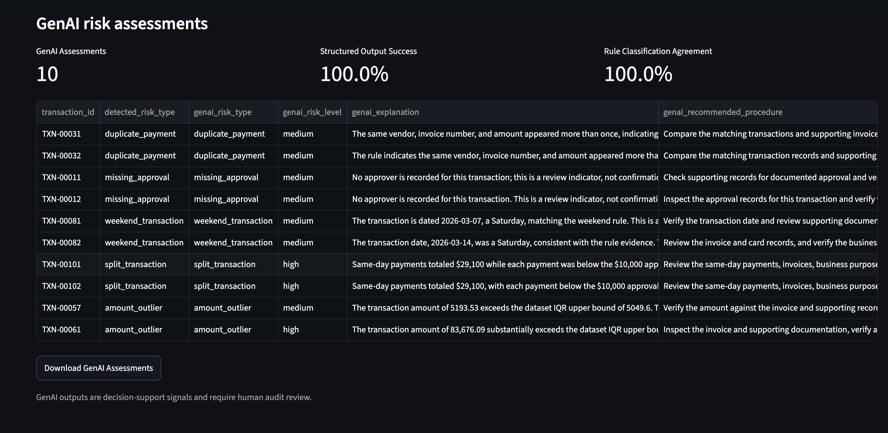

# GenAI Audit Risk Analyzer

A Python and Streamlit application that combines deterministic audit
analytics with structured generative AI outputs to identify, explain,
and review potential risks in procurement transaction data.

This project was developed as a portfolio demonstration using entirely
synthetic data. It is not intended to replace professional audit
judgment.

## Business Problem

Internal audit teams often review large transaction datasets for
potential control exceptions such as duplicate payments, missing
approvals, transaction splitting, weekend activity, and unusually large
amounts.

Rule-based analytics can identify suspicious records consistently, but
the resulting flags still require interpretation and follow-up. This
project combines reproducible Python controls with GenAI-generated risk
explanations and recommended audit procedures.

## Key Features

- Generates 1,000 synthetic procurement transactions with seeded risks
- Detects five audit-risk patterns using deterministic Python rules
- Uses IQR analysis to identify unusual transaction amounts
- Produces structured GenAI risk classifications using JSON Schema
- Generates concise explanations and recommended audit procedures
- Preserves the separation between calculated evidence and AI narrative
- Displays audit metrics and risk distributions in Streamlit
- Exports flagged transactions and GenAI assessments to CSV
- Includes automated tests for core risk-detection rules
- Uses saved GenAI results to avoid repeated API charges on page refresh

## Risk Rules

The application detects:

1. Duplicate payments
2. Missing approvals
3. Weekend transactions
4. Potential split transactions below an approval threshold
5. Amount outliers based on the interquartile range

A transaction may trigger more than one rule. Every flag is treated as
a review indicator rather than a confirmed audit finding.

## Architecture

```text
Synthetic transaction data
        |
        v
Data validation and preparation
        |
        v
Deterministic audit-risk rules
        |
        v
Flagged transactions and rule evidence
        |
        v
OpenAI Structured Outputs enrichment
        |
        v
Streamlit dashboard and downloadable results
        |
        v
Evaluation and human audit review
```

## GenAI Design

The language model does not calculate transaction totals or independently search the complete dataset. Python performs the deterministic analysis first.

The model receives only:

- The flagged transaction
- The detected risk category
- Deterministic rule evidence

The model returns a strict structured response containing:

- Risk type
- Risk level
- Concise explanation
- Recommended audit procedure

This design reduces unsupported numerical claims and keeps the analytical evidence traceable.

## Pilot Results

The current synthetic dataset contains:

- 1,000 total transactions
- 53 manually seeded risk records
- 98 generated risk flags
- 5 risk categories
- 10 stratified GenAI assessment samples

Pilot GenAI evaluation:

- Structured-output success rate: 100%
- Rule-classification agreement rate: 100%
- Evaluation sample size: 10

These pilot results demonstrate schema reliability and initial classification agreement. They should not be interpreted as production accuracy because the evaluation sample is small and the reference labels are generated from deterministic rules rather than independent expert review.

## Dashboard



## Project Structure

```text
genai-audit-risk-analyzer/
├── app.py
├── data/
│   ├── synthetic_transactions.csv
│   ├── flagged_transactions.csv
│   ├── genai_risk_assessments.csv
│   └── evaluation_summary.csv
├── screenshots/
│   └── genai_dashboard.png
├── src/
│   ├── __init__.py
│   ├── batch_enrichment.py
│   ├── data_generator.py
│   ├── evaluate.py
│   ├── llm_enrichment.py
│   ├── report_generator.py
│   └── risk_rules.py
├── tests/
│   └── test_risk_rules.py
├── .env.example
├── .gitignore
├── README.md
└── requirements.txt
```

## Installation

Create and activate a virtual environment:

```bash
python3 -m venv .venv
source .venv/bin/activate
```

Install the required packages:

```bash
python -m pip install -r requirements.txt
```

## Environment Configuration

Create a local `.env` file in the project directory:

```text
OPENAI_API_KEY=your_api_key_here
OPENAI_MODEL=your_available_model_name
```

Never commit the `.env` file or a real API key to source control.

The repository includes `.env.example` to document the required environment variables without exposing credentials.

## Usage

Generate the synthetic dataset:

```bash
python -m src.data_generator
```

Run deterministic risk detection:

```bash
python -m src.risk_rules
```

Test one structured GenAI assessment:

```bash
python -m src.llm_enrichment
```

Generate a stratified GenAI assessment sample:

```bash
python -m src.batch_enrichment
```

Evaluate the saved GenAI results:

```bash
python -m src.evaluate
```

Run automated tests:

```bash
python -m pytest -v
```

Launch the Streamlit dashboard:

```bash
python -m streamlit run app.py
```

## Responsible AI and Limitations

- All included transaction data is synthetic.
- Risk flags are indicators for review, not confirmed findings.
- GenAI outputs require human audit validation.
- The pilot evaluation contains only 10 records.
- Rule agreement is not equivalent to real-world model accuracy.
- Production deployment would require access controls, monitoring, privacy review, larger expert-labeled evaluation sets, and documented escalation procedures.
- Approval thresholds and risk rules would need to be aligned with an organization's actual policies.

## Technology

- Python
- Pandas
- NumPy
- Streamlit
- Plotly
- OpenAI API
- Structured Outputs
- Pytest
